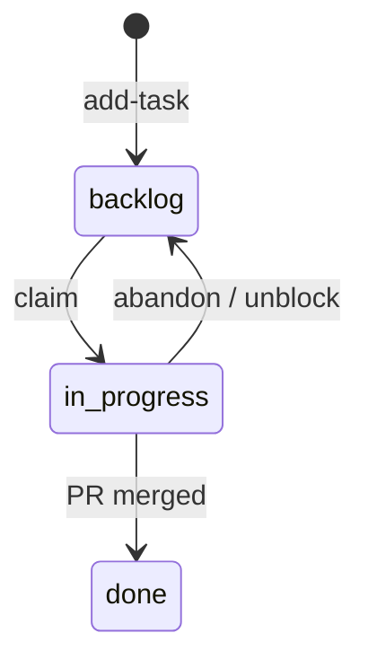

# Координация: ветки, задачи, merge

## Принципы

1. **Один агент — одна активная задача** из `tasks/in-progress/`.
2. **Один модуль — один владелец** на время задачи (см. `OWNERSHIP.md`).
3. **Маленькие и частые коммиты** с префиксом id задачи: `T03: добавить проверку суммы бюджета` — не копить правки «до идеала»; пушить ветку на remote, чтобы остальные видели прогресс (см. ниже).
4. **Не рефакторить** чужие зоны «заодно».
5. **Источник правды по продукту** — `docs/PRODUCT.md`; расхождения — issue/коммент в задаче, не молчаливое изменение MVP.

## Ветки

```
main                          ← интеграция, демо
agent/<ник>/<task-id>         ← работа исполнителя
```

Пример: `agent/pavel/T05-quest-unplanned-purchase`

Правила:

- Не коммитить напрямую в `main`, кроме срочных hotfix по договорённости.
- Перед началом: `git fetch` и rebase/merge от `main`.
- После merge задачи — удалить ветку.

## Жизненный цикл задачи



### Claim (заявить задачу)

В frontmatter задачи:

```yaml
---
id: T03
status: in-progress
claimed-by: pavel
branch: agent/pavel/T03-teen-budget-quest
started: 2026-10-27
---
```

Переместить файл: `tasks/backlog/T03-....md` → `tasks/in-progress/T03-....md`

Если задача **зависит** от другой (`depends-on: T02`), не брать, пока зависимость не в `tasks/done/`.

## Merge и конфликты

| Ситуация | Действие |
|----------|----------|
| Конфликт в `app/main.py` | Согласовать с интегратором; по возможности разнести точки входа по `app/pages/` |
| Два агента правят одну зону | Стоп: пересмотреть разбиение задач |
| Нужно изменить `src/domain/constants.py` | Одна задача «контракты» (T02), остальные только читают |

**Интегратор** (роль на хакатоне): следит за `main`, порядком merge, демо-данными.

## Проверка перед PR

```bash
python -m venv .venv && source .venv/bin/activate
pip install -r requirements.txt
streamlit run app/main.py
```

Минимум: сценарий из acceptance criteria задачи + переключение ролей, если затронут UI.

## Ретро по последним коммитам (анализ и улучшения)

После логичного шага, перед PR или по запросу человека — просмотреть **последние 1–2 коммита** на текущей ветке и предложить улучшения **текстом**, без самовольного рефакторинга.

```bash
git log -2 --oneline
git show HEAD          # при одном коммите
git show HEAD~1..HEAD  # при двух
```

На что смотреть:

| Область | Вопросы |
|---------|---------|
| Задача и MVP | Соответствует acceptance criteria и `docs/PRODUCT.md`? Нет лишнего вне MVP? |
| Архитектура | SQL только в `src/db/`? Domain/quests без Streamlit? UI без бизнес-логики? |
| Качество | Покрыты ли рискованные ветки тестом или smoke? Дубли, магические числа вне `src/domain/`? |
| Координация | Правки только в `owns:` задачи? Сообщения коммитов понятны коллегам? |

Формат ответа агенту (кратко):

1. **Что сделано** — 1–2 предложения по diff.
2. **Сильные стороны** — что оставить как есть.
3. **Улучшения** — 2–5 пунктов: конкретный файл/место, зачем, приоритет (низкий / средний / высокий).
4. **Следующий шаг** — что править сейчас vs отложить до отдельной задачи.

Улучшения внедрять только если человек явно просит или это блокер для PR (падает `verify.sh`, нарушение `OWNERSHIP.md`).

## Частота коммитов и видимость для команды

- **Коммить по ходу работы**, а не одним коммитом перед PR: закончился логичный шаг (функция, экран, миграция, тест) — зафиксируй.
- **Пушить ветку регулярно** (`git push -u origin HEAD` при первом пуше, дальше `git push`): локальные коммиты не видны участникам.
- **Ориентир:** хотя бы раз в несколько часов активной работы или после каждого проходящего `./scripts/verify.sh` / smoke из задачи — что наступило раньше.
- На ветке `agent/...` допустимы промежуточные коммиты; перед merge в `main` историю можно слегка подчистить, но не вычищать всё в один «чёрный ящик».
- В сообщении коммита кратко укажи **зачем** шаг — по `git log` и diff на remote проще понять, чем занимается коллега, и не дублировать работу.

## Сообщения коммитов

Формат: `<TASK_ID>: <кратко что и зачем>`

Примеры:

- `T01: каркас Streamlit и переключатель роли`
- `T08: сохранение запроса родителя в SQLite`
